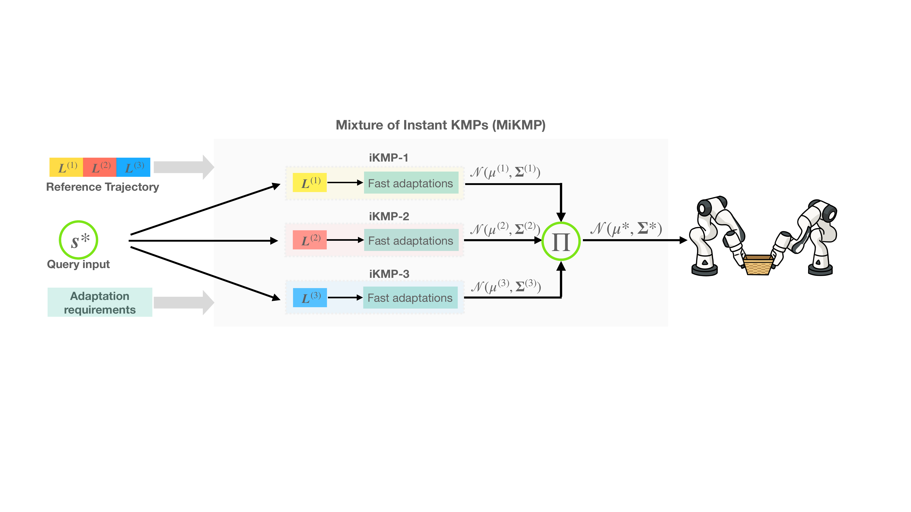

# A Computationally Efficient Nonparametric Approach for Robot Imitation Learning

[Paper](https://elib.dlr.de/222563/1/ICRA26_2776_FI.pdf)  
[Video](https://www.youtube.com/watch?v=XKrzqp05U1M&feature=youtu.be)

Yijin Wang, Shaokang Wu, Chen Liu, Chuankai Zhang, Joao Silverio, Yanlong Huang <br/>

University of Leeds <br/>

<p align="center">
  <strong>An overview of the MiKMP framework</strong><br>
  
</p>


This repository contains the implementation of our paper,
[A Computationally Efficient Nonparametric Approach for Robot Imitation Learning](https://elib.dlr.de/222563/1/ICRA26_2776_FI.pdf). If you find this work useful in your research, please cite:

```
@inproceedings{wang2026computationally,
  title={A Computationally Efficient Nonparametric Approach for Robot Imitation Learning},
  author={Wang, Yijin and Wu, Shaokang and Liu, Chen and Zhang, Chuankai and Silverio, Joao and Huang, Yanlong},
  booktitle={2026 IEEE International Conference on Robotics and Automation, ICRA 2026},
  year={2026},
  organization={IEEE}
}
```

### Usage

To reproduce the results reported in the paper, run one of the following:

```Shell
cd benchmarking_A
python MiKMP_benchmark.py
```

or

```Shell
cd benchmarking_G
python MiKMP_benchmark.py
```